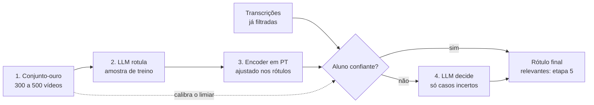

# Proposta: filtro de relevância com IA (etapa 4)

A etapa 4 deve tirar do corpus (cerca de 30 mil vídeos) os que não tratam do tema, de forma inclusiva. A proposta é filtrar em camadas, da mais barata para a mais cara: regra lexical nos metadados, legendas do YouTube e, por fim, um classificador sobre a transcrição, adaptado do MythTriage (EMNLP 2025).

## Critério de relevância

É relevante qualquer vídeo que mencione o uso de agonistas de GLP-1 para emagrecimento, mesmo que o tema principal seja outro. Na dúvida, o vídeo entra: um falso positivo ainda pode ser marcado como "irrelevante" na anotação humana, mas um falso negativo se perde de vez.

- **Entra:** qualquer fármaco da família (semaglutida, liraglutida, tirzepatida e afins), citado pelo nome, pela marca ou só como "caneta emagrecedora";
- **Sai:** vídeos sem relação com esses fármacos,  como homônimos, temas trazidos pela busca por acaso ou conteúdo sem fala sobre o assunto. Vídeos sobre emagrecimento que não mencionam tais fármacos também ficam de fora.

## Filtro em camadas

Cada camada decide o que consegue e repassa o resto para a próxima. Na dúvida, o vídeo segue adiante.

1. **Metadados, regra lexical.** Se título, descrição ou tags contêm um termo de busca ou sinônimo, o vídeo passa direto. O código já existe (hoje é usado só na análise temporal). Esta camada não rejeita ninguém: quem não bate vai para a camada 2.
2. **Legendas do YouTube** Para os ainda duvidosos, baixar só a legenda com yt-dlp (mais barato que whisper) e procurar os termos .**Áudio e Whisper** só para quem passou.

( O download dos áudios e o processamento pelo Whisper entra apenas nessa etapa. Podemos aplicar também o filtro de linguagem nessa etapa)

3. **Classificador sobre a transcrição gerada pelo Whisper.** O classificador descrito abaixo remove o que ainda sobrou de irrelevante. Se as camadas anteriores já tirarem quase todo o lixo, esta camada pode se reduzir a um LLM sobre a transcrição, sem a cascata completa.

**Risco:** um vídeo rejeitado antes do download nunca é transcrito, então esse erro fica invisível nas etapas seguintes. É preciso transcrever e anotar uma amostra dos rejeitados nas camadas 2 e 3 para estimar quantos vídeos relevantes se perdem.

## Camada final: classificador na transcrição

1. **Conjunto-ouro.** Duas pessoas anotam uma amostra seguindo o critério acima. Ela é usada para medir todos os modelos e escolher o limiar de confiança.
2. **LLM como professor.** Um LLM aberto do Hugging Face (Qwen, Gemma ou Llama, por exemplo) recebe o critério e alguns exemplos no prompt e rotula alguns milhares de vídeos a partir do título, da descrição e da transcrição. A saída é um JSON com o rótulo e uma justificativa curta.
3. **Encoder como aluno.** Um modelo pequeno em português (BERTimbau ou Albertina) é ajustado nesses rótulos e classifica o corpus inteiro, em minutos e a custo baixo.
4. **Adiamento.** Quando a confiança do aluno fica abaixo do limiar, o vídeo vai para o LLM. O limiar é escolhido para maximizar o recall da classe "relevante".

## Validação

- **Conjunto-ouro:** 300 a 500 vídeos sorteados por query e ano, anotados por duas pessoas (κ de Cohen). Uma parte serve para escolher o limiar, a outra para reportar o resultado. Ela precisa incluir vídeos rejeitados pelas camadas de metadados, senão o erro dessas camadas não é medido.
- **Métrica principal:** recall da classe "relevante", porque o objetivo é não perder vídeos. A precisão pode ser mais baixa, já que a anotação humana remove o que sobrar.
- **Comparar antes de fixar o desenho:** um LLM zero-shot sozinho, o classificador treinado com rótulos do LLM e a cascata completa. Como o critério é amplo, um LLM sozinho pode já bastar. Se bastar e o custo de rodar 30 mil transcrições couber na infraestrutura, a cascata é desnecessária.
- **Cuidados:** transcrições longas precisam ser divididas em trechos (o vídeo é relevante se algum trecho for), porque truncar perde menções tardias. Também vale fixar a versão do modelo e o prompt, e usar temperatura 0, para garantir a reprodutibilidade.

## Referências

- MythTriage: LLM rotula, DeBERTa aprende, casos incertos voltam ao LLM; vídeos do YouTube sobre opioides; custo cerca de 94% menor que usar só o GPT-4o e F1-macro mediano de 0,81 contra especialistas (<https://arxiv.org/abs/2506.00308>)
- Classificadores treinados com rótulos do GPT-4 ficam comparáveis aos treinados com rótulos humanos em 14 tarefas (<https://consensus.app/papers/details/w:04d9472c-888b-4956-9db0-5211aeb4fddc/>)
- Ressalva: erros do LLM se propagam para o classificador, daí a necessidade do conjunto-ouro (<https://consensus.app/papers/details/w:3cfaed08-d159-4d1c-93ef-8acee09f20a2/>)
- ChatGPT zero-shot superou crowdworkers em tarefas de relevância e tópico (<https://consensus.app/papers/details/w:33d1397b-5127-4b4e-a2e5-6a29a83febdc/>)
- LLMs abertos como anotadores para relevância e tópico (<https://consensus.app/papers/details/w:9cbb308d-ac58-4350-972a-d12db0d3f842/>)
- Em coletas por palavra-chave no YouTube, de 30% a 40% dos vídeos são irrelevantes: Papadamou et al., com classe "irrelevante" na anotação (<https://ojs.aaai.org/index.php/ICWSM/article/view/19329>), e Fialho et al., com vídeos em português (<https://consensus.app/papers/details/w:35262a46-21be-4c6c-8329-5335595e7024/>)
- Truncar ou resumir transcrições aumenta os falsos negativos em LLMs (<https://consensus.app/papers/details/w:fe5c275c-fdc8-4617-8870-14476bfeff76/>)